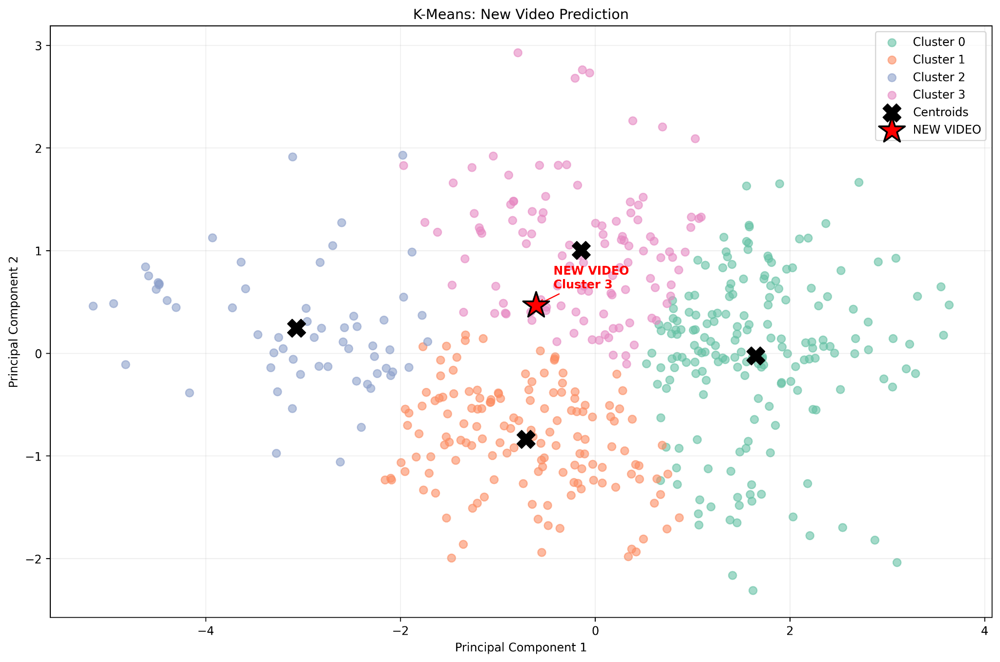

# YouTube Video Analytics & K-Means Clustering

**Unsupervised machine learning project** exploring YouTube video engagement using the YouTube Data API, pandas, scikit-learn, PCA, and an interactive Gradio interface.

## Overview

- Collected and analyzed **500 YouTube videos** about artificial intelligence using the **YouTube Data API v3**.
- Built clustering features from **views, likes, comments, and duration (seconds)**.
- Filled missing engagement values with medians, parsed ISO 8601 video durations, applied `log1p` and standardized features.
- Compared cluster solutions with **inertia (elbow method)** and **silhouette scores**.
- Selected **K=4** for more interpretable segments even though **K=2** had the higher silhouette score (**0.3946** vs **0.3387** for K=4).
- Built a **Gradio UI** that predicts a cluster for new video metrics, displays characteristic 25th–75th percentile ranges, and plots the video alongside clusters using PCA.

## Cluster interpretation

| Cluster | Interpretation | Videos |
|---|---|---:|
| 0 | High-Reach Videos | 184 |
| 1 | Short Videos with Moderate Reach | 145 |
| 2 | Low-Reach Videos | 60 |
| 3 | Long-Form Videos with Moderate Reach | 111 |

Cluster IDs are specific to this trained model. Labels summarize observed group behavior, not guaranteed ground-truth categories.

## Example prediction visualization



The red star marks a new video's projected position; black crosses represent the cluster centers in two-dimensional PCA space.

## Repository structure

```text
YouTube-KMeans-Clustering/
├── README.md
├── YouTube_KMeans_Project.ipynb
├── requirements.txt
├── .gitignore
├── data/
│   ├── youtube_ai_dataset.csv      # Small early export (50 rows)
│   └── youtube_kmeans_final.csv    # Processed 500-video dataset with cluster labels
├── images/
│   └── KMeans_PCA_Visualization.png
└── models/
    └── youtube_kmeans_model.pkl   # Serialized model + preprocessing + PCA
```

## How to explore

**Google Colab (recommended for the original notebook):**

1. Open `YouTube_KMeans_Project.ipynb` in Google Colab.
2. Install dependencies from `requirements.txt` or run the notebook's installation cells.
3. To retrieve fresh video data, create a YouTube Data API v3 key and save it in **Colab Secrets** as `YOUTUBE_API_KEY`. **Never paste keys into the notebook or commits.**
4. Run the notebook cells in order. Later sections show model comparison, K=4 segmentation, PCA visualization and Gradio prediction.
5. The last standalone UI cell expects `youtube_kmeans_model.pkl` and `youtube_kmeans_final.csv` to be uploaded into the Colab session. Download the files from the `models/` and `data/` folders first.

**Note:** The notebook is a research workflow with exploratory iterations, including both K=2 and K=4, rather than a single clean production script. The original notebook uses Colab-specific modules and file-upload steps. The provided saved dataset lets readers inspect the final clusters without making API requests.

## Tech stack

Python · pandas · NumPy · scikit-learn · Matplotlib · Seaborn · Gradio · YouTube Data API v3 · isodate · joblib · Google Colab

## Security and reproducibility

- No API key is included in the published project files; keep `YOUTUBE_API_KEY` only in Colab Secrets.
- **Only deserialize `.pkl` files from sources you trust.** `joblib.load()` can execute arbitrary code during loading.
- API search results, metrics, and package versions can vary over time; cluster labels depend on the fitted model.
- The raw `youtube_ai_dataset.csv` is an earlier 50-row sample; the finalized CSV has 500 rows and is not simply a cleaned copy of that sample.

## Author

**Youssef Helmy** · [GitHub](https://github.com/YoussefHelmy22) · [LinkedIn](https://www.linkedin.com/in/youssef-helmy-b0217b213)
